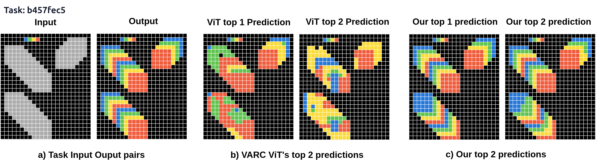
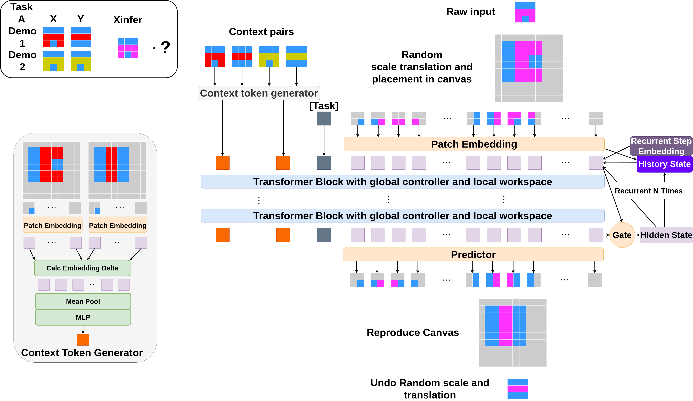
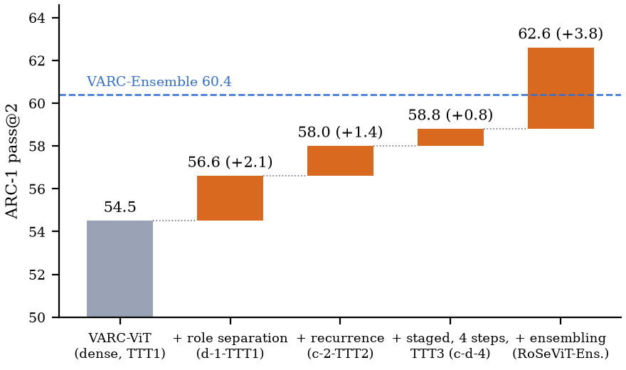

# RoSeViT: Role-Separated Vision Transformers for ARC Visual Reasoning



Official code for the NeurIPS 2026 paper **RoSeViT: Role-Separated Vision Transformers for ARC Visual Reasoning**
(Zhiguang Liu, Yi Shang; University of Missouri).

ARC tasks are visual transformation problems: infer a rule from a few demonstrations and apply it consistently across a
grid. A dense Vision Transformer makes every patch token carry both its local grid state and the global rule. RoSeViT
separates the two roles: **controller tokens** (one task token plus one context token per demonstration) aggregate the
transformation-level instruction, **workspace tokens** hold the grid, and each block runs a dense pass followed by a
structured pass in which controllers attend globally while workspace tokens attend only to the controllers and a 3x3
neighbourhood. Dropped into the fixed [VARC](https://github.com/lillian039/VARC) pipeline with nothing else changed,
the backbone swap raises ARC-1 pass@2 from 54.5 to 56.6 at matched parameters, the best single model reaches 58.8, and
RoSeViT-Ensemble improves VARC-Ensemble from 60.4 to 62.6.



## Results (ARC pass@2, VARC protocol)

| Model | #param | ARC-1 | ARC-2 | Notes |
|---|---|---|---|---|
| VARC-ViT (dense) | 18M | 54.5 | 8.3 | VARC, CVPR 2026 |
| VARC-ViT, width-matched (dense) | 28M | 53.6 | – | parameter-matched control, 8 TTT seeds |
| RoSeViT d-1-TTT1 | 28M | **56.6** | 6.9 | the controlled backbone swap |
| RoSeViT c-2-TTT2 | 28M | 58.0 | 8.3 | two recurrent steps |
| RoSeViT c-d-4-TTT3 | 28M | **58.8** | **11.0** | best single model (released checkpoint) |
| VARC-Ensemble | 73M | 60.4 | 11.1 | |
| RoSeViT-Ensemble | 83M | **62.6** | **13.5** | c-d-4-TTT3 + VARC's released predictions |



Role separation alone contributes +2.1 in the controlled swap; recurrence, staged training with TTT3, and ensembling add
+1.4, +0.8 and +3.8 on top, and every amplifier is shared machinery available to both backbones. Compute: the structured
pass is added on top of the dense pass; our implementation runs it as dense attention under a mask, so RoSeViT d-1 costs
97.3 GFLOPs and 46.1 ms per batch of 8 on an H100, about 2.1x the matched dense control (no efficiency claim is made).

## Environment

```
conda create -n rosevit python=3.10
conda activate rosevit
pip install -r requirements.txt
hf auth login      # only needed to download the checkpoint / predictions
wandb login        # optional
```

## Download the trained checkpoint and predictions

We release the best single model, **RoSeViT c-d-4** after offline training (it still needs test-time training to produce
the numbers above), and the predictions behind our ARC-1/ARC-2 rows.

```
mkdir -p saves/rosevit_cd4
hf download lz7fdmu/RoSeViT --local-dir saves/rosevit_cd4
hf download lz7fdmu/RoSeViT_predictions --local-dir . --repo-type dataset
unzip RoSeViT_predictions.zip
```

For the ensemble you also need VARC's released predictions: `hf download VisionARC/VARC_predictions --local-dir . --repo-type dataset && unzip VARC_predictions.zip`.

Scores and HTML galleries from downloaded predictions:

```
bash script/analysis/arc_1_rosevit.sh      # arc_agi_1_rosevit.html
bash script/analysis/arc_1_ensemble.sh     # arc_agi_1_rosevit_ensemble.html
bash script/analysis/arc_2_rosevit.sh
bash script/analysis/arc_2_ensemble.sh
```

## Reproduce from scratch

### 1. Data

```
bash raw_data/download_data.sh     # ARC-AGI-1, ARC-AGI-2, RE-ARC (nothing is vendored)
python augment_data.py             # VARC's augmented TTT splits
bash script/sanity_ARC1.sh         # optional one-task sanity checks
bash script/sanity_ARC2.sh
```

### 2. Offline training

All offline runs train on the ARC-1 training tasks with RE-ARC expansion; ARC-2 is never used for offline training.
Scripts take `NPROC` and `BATCH` (per GPU); the defaults are the settings behind the paper's numbers.

| Script | Model | Block / neighbourhood / steps | Epochs | Timing |
|---|---|---|---|---|
| `script/offline/rosevit_d1.sh` | **d-1** (Table 1, controlled swap) | dense + structured / 8 / 1 | 100 | about 2 days on 2 H100s (global batch 128), or 12 h on 8 |
| `script/offline/ablation_a1.sh` | variant a | structured only / none / 1 | 100 | similar |
| `script/offline/ablation_b1.sh` | variant b | structured only / 8 / 1 | 100 | similar |
| `script/offline/ablation_c1.sh` | variant c | dense + structured / none / 1 | 100 | similar |
| `script/offline/rosevit_c4_stage1.sh` | c-4, stage 1 | dense + structured / none / 4 | 100 | 5 to 10 h per 30 epochs on 8 B200s |
| `script/offline/rosevit_cd4_stage2.sh` | **c-d-4**, stage 2 | resume c-4, neighbourhood 8 / 4 | 30 | as above; produces the released checkpoint |

Stage 2 of c-d-4 runs 30 epochs with a cosine schedule starting at 3e-5, i.e. the learning-rate range that the
stage-1 schedule covers over its epochs 71 to 100. The paper's c-2 row came from an early checkpoint trained with a
previous version of this code base and has no script here; variant c with `--recurrent-depth 2` is the equivalent
configuration.

The variant letters follow the paper's Figure 4; in code they are two flags:

| Paper variant | `--architecture` | `--patch-local-attn` | Workspace tokens see |
|---|---|---|---|
| a | `vit_struct` | `none` | controllers only (no dense pass) |
| b | `vit_struct` | `8` | controllers + 3x3 neighbourhood (no dense pass) |
| c | `vit_dense` | `none` | dense pass, then controllers only |
| **d** (RoSeViT) | `vit_dense` | `8` | dense pass, then controllers + 3x3 neighbourhood |

`--recurrent-depth r` sets the number of recurrent refinement steps (`d-1`, `c-4`); `vit_dense` is the RoSeViT
block (dense pass followed by the structured pass), not a plain dense ViT. The plain dense baselines of the paper
(VARC-ViT 18M, 66M, and the width-matched 28M control) are trained with the official VARC code; the exact commands are
in `script/varc_baseline/`.

### 3. Test-time training

One script covers every setting and benchmark; the two commands below are the paper's controlled comparison
(d-1-TTT1) and best single model (c-d-4-TTT3), and `script/ttt/README.md` lists the settings:

```
CKPT=saves/rosevit_d1/checkpoint_final.pt  SETTING=TTT1 REC=1 PLA=8 SAVE=ARC_1_d1_TTT1  bash script/ttt/ttt.sh
CKPT=saves/rosevit_cd4/checkpoint_final.pt SETTING=TTT3 REC=4 PLA=8 SAVE=ARC_1_cd4_TTT3 bash script/ttt/ttt.sh
DATASET=ARC-AGI-2 CKPT=saves/rosevit_cd4/checkpoint_final.pt SETTING=TTT3 REC=4 PLA=8 SAVE=ARC_2_cd4_TTT3 bash script/ttt/ttt.sh
```

ARC-1 TTT over the 400 evaluation tasks takes roughly 10 to 20 hours on an 8-GPU node (ARC-2 has 120 tasks and is
faster). Expected results: d-1-TTT1 about 56 to 57 on ARC-1 (56.6 is the mean of 4 runs) and 6 to 8 on ARC-2;
c-d-4-TTT3 about 58 to 59.5 on ARC-1 (58.8 +- 0.7) and 10 to 12 on ARC-2 (11.0 +- 1.0). VARC reports [52, 56] for
its own ViT under the same protocol.

### 4. Analysis

```
bash script/analysis/arc_1_rosevit.sh      # edit --output-root to your SAVE name
bash script/analysis/arc_1_ensemble.sh
```

## Appendix experiments

`appendix/` holds the controller ablation, rule probes, route blockade and the weight-matched post-TTT ablation
(`ROSE_DUAL_EVAL=1`) of Appendix D, and `maze/` the instruction-conditioned maze suite of Appendix E (preliminary
transfer evidence). Each folder has its own README with the commands.

## Important hyperparameters

| Parameter | Meaning |
|---|---|
| `architecture` | `vit_dense` (RoSeViT block: dense pass + structured pass), `vit_struct` (structured pass only), `unet` (VARC's UNet) |
| `patch-local-attn` | workspace neighbourhood in the structured pass: `8` (3x3) or `none` |
| `recurrent-depth` | recurrent refinement steps over the block stack |
| `max-ctx-tokens` | context tokens, one per demonstration pair (4) |
| `depth`, `embed-dim`, `num-heads`, `mlp-dim` | block count 10, width 512, 8 heads, MLP width 512 |
| `image-size`, `patch-size`, `num-colors` | 64x64 canvas, 2x2 patches, 10 colours + background + border |
| `epochs`, `num-success`, `learning-rate` | TTT budget, early-stop streak, learning rate (see `script/ttt/README.md`) |
| `correct-lambda`, `ce-reward-weight-correct`, `no-ttt-aux-loss` | TTT3 adaptation-only objectives / disable them |
| `num-attempts`, `ttt-num-each` | random perspectives per pseudo task (10), independent TTT runs per task (2) |
| `resume-checkpoint`, `resume-skip-task-token`, `eval-save-name` | offline checkpoint, fresh task token for an unseen task, output folder under `outputs/` |

## Acknowledgement

This repository is built on [VARC](https://github.com/lillian039/VARC) (Hu et al., CVPR 2026): the data pipeline,
augmentation, training and test-time-training loops, voting inference and analysis code are theirs; RoSeViT replaces the
backbone (`src/ARC_ViT_dense.py`, `src/ARC_ViT_struct.py`) and adds the scripts and experiments above. Both are MIT
licensed.

## Citation

```
@inproceedings{liu2026rosevit,
  title     = {{RoSeViT}: Role-Separated Vision Transformers for {ARC} Visual Reasoning},
  author    = {Zhiguang Liu and Yi Shang},
  booktitle = {Advances in Neural Information Processing Systems (NeurIPS)},
  year      = {2026}
}
```
