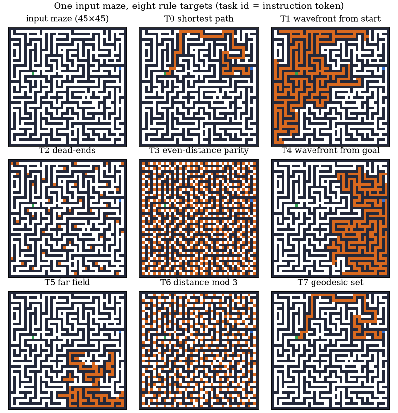

# Instruction-conditioned maze suite (paper Appendix E)

A second visual-transformation task family used as preliminary transfer evidence: one input maze, eight
BFS-derived rules selected by a task id, parameter-matched RoSeViT and dense ViT backbones, feedforward,
offline training only, no test-time training, no voting, no ensembling.



* Mazes: 45x45 corridor mazes on a 48x48 canvas (recursive backtracking, ~4% walls knocked out for loops),
  start/goal with BFS shortest-path length >= 45, generated on the fly (`mazegen.py`).
* Rules (`multitask.py`): T0 shortest path, T1 wavefront from start, T2 dead-ends, T3 even-distance parity,
  T4 wavefront from goal, T5 far field, T6 distance mod 3, T7 geodesic set. Eval: a fixed held-out set of
  128 mazes x 8 rules, exact match of the full grid (T0 also scored by the strict path checker in `eval_taxonomy.py`).
* Models (`model.py`): width 512, 8 heads, patch 2 (24x24 = 576 grid tokens). RoSeViT: depth 8 (33.99M),
  dense pass -> structured pass (5 controller tokens attend globally; grid tokens see controllers + 3x3
  neighbourhood) -> MLP, zero-init gates. Dense ViT: pre-LN blocks, depth 11 (35.02M). The task id is one
  learned embedding given to both models (RoSeViT through its task token, the dense model as an extra
  globally attended token).
* Training: AdamW 3e-4 with cosine decay, bf16, global batch 256, 40k steps, eval every 5k steps.

Commands used for the appendix (two GPUs per arm, per-rank batch 128; `MAZE_CANVAS=48` selects the 48x48 canvas):

```
# RoSeViT, seed 42 / 43
MAZE_CANVAS=48 torchrun --nproc_per_node=2 train.py --rose --depth 8  --tasks 8 --sizes 45 --steps 40000 --bs 128 --lr 3e-4 --eval-every 5000 --seed 42 --out runs/rose_s42
# dense ViT, seed 42 / 43
MAZE_CANVAS=48 torchrun --nproc_per_node=2 train.py        --depth 11 --tasks 8 --sizes 45 --steps 40000 --bs 128 --lr 3e-4 --eval-every 5000 --seed 42 --out runs/dense_s42
```

`gen_hrm_style.py` / `hrm_data.py` reproduce the HRM Maze-Hard-1k check mentioned in the appendix
(feedforward models of both architectures score 0% there, as the HRM paper itself reports for
non-recurrent Transformers). Run `python train.py -h` for all options.
